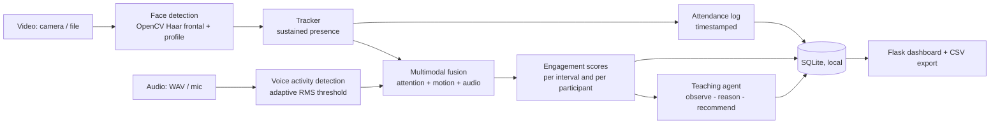

# Multimodal Attendance & Engagement Agent (MAEA)

An AI-powered, **privacy-preserving, fully offline** classroom intelligence system. It combines computer vision,
audio signal processing and an agent-based reasoning layer to:

1. **Automatically track attendance** from a live or recorded video feed (sustained-presence logic, timestamped logs)
2. **Analyse engagement** from head pose, movement, inactivity and audio activity (multimodal fusion)
3. **Generate teaching suggestions** (pacing, interactive activities, classroom management) as assistive decision support
4. **Show everything on a local dashboard** with attendance, engagement trends, analytics and CSV export

> Skill Wallet capstone project. Everything runs on `localhost`; no video, audio, face data or analytics leave the machine.

## Quick start

```bash
git clone <your-repo-url> && cd multimodal-attendance-engagement-agent
python -m venv .venv && source .venv/bin/activate      # Windows: .venv\Scripts\activate
pip install -r requirements.txt

python run.py --demo          # simulated classroom, prints a full report (no camera needed)
python run.py                 # dashboard at http://127.0.0.1:5000  (click "Run demo" or upload a video)
python run.py --cli class.mp4 --audio class.wav   # analyse a recording from the terminal
python run.py --cli 0         # live webcam (index 0); stop with Ctrl+C in a recorded clip workflow
python -m pytest -q           # run the test suite
```

Audio is read from a WAV file (`--audio` / dashboard upload). If `ffmpeg` is installed locally it is used
automatically to extract audio from the video; otherwise the system runs in vision-only mode and re-normalises the weights.

## How it works



| Layer | Module | Responsibility |
|---|---|---|
| Frontend | `maea/templates/dashboard.html`, `maea/app.py` | Dashboard, upload, REST API |
| Vision | `maea/detectors.py`, `maea/tracker.py` | Face detection, head-pose proxy, tracking, sustained presence |
| Audio | `maea/audio.py` | WAV loading, energy VAD, speech ratio, turn onsets |
| Fusion | `maea/engagement.py` | Weighted multimodal engagement score and trends |
| Agent | `maea/agent.py` | Rule-based teaching suggestions with rationale |
| Storage | `maea/storage.py` | Local SQLite + CSV export |
| Orchestration | `maea/pipeline.py`, `run.py` | End-to-end analysis and CLI |

### Key algorithms

* **Sustained presence**: a participant is marked present only after being tracked for `min_presence_sec` (default 10 s);
  brief appearances (someone walking past) are counted as *ignored*, removing single-frame false positives. Short
  occlusions (`max_gap_sec`) don't break a track.
* **Head pose proxy**: a frontal-face hit means *facing forward*; a profile-only hit means *looking away*.
* **Movement and inactivity**: centroid displacement normalised by face width. Frozen for `inactivity_sec` = inactive; excessive motion = restless.
* **Audio**: frame RMS vs. an adaptive noise-floor threshold, median-smoothed, giving speech ratio and turn onsets per interval.
* **Fusion**: `engagement = (w_att*attention + w_mot*motion + w_aud*audio) / sum(w)` (defaults 0.5 / 0.2 / 0.3, in `config.py`).
  Labels: High >= 70%, Medium >= 45%, Low below that.
* **Agent**: detects sustained low engagement, sharp drops, long silences, continuous lecturing, abnormal movement, late arrivals,
  second-half decline, and highlights the peak interval, each with a human-readable rationale.

## Privacy and ethics

* 100% offline: no cloud APIs; binds to `127.0.0.1`.
* **No face recognition or embeddings**: participants are anonymous (`Participant N`); only box geometry is used transiently.
* No frames are saved; only numeric analytics are stored in a local SQLite file you can delete from the dashboard.
* Suggestions are assistive and never enforce decisions. Obtain consent and follow your institution's policy before deploying in a real classroom.

## Testing and evaluation

`tests/test_core.py` covers sustained presence, transient rejection, occlusion handling, multi-person tracking, inactivity,
VAD accuracy, fusion maths, an end-to-end simulated session (engagement dip detected and flagged by the agent), storage,
REST API and detector loading. `maea/simulate.py` provides a deterministic simulated classroom with a known engagement dip
so accuracy can be checked against ground truth. Haar cascades are lightweight but sensitive to lighting and angle;
for higher accuracy swap in another detector implementing `detect(frame) -> [Detection]`.

## Project structure

```
maea/        core package (config, tracker, detectors, audio, engagement, agent, pipeline, storage, app)
tests/       pytest suite
docs/        architecture and epic-by-epic workflow mapping
run.py       CLI + dashboard entry point
```

## Roadmap
Pluggable detectors (MediaPipe / ONNX), live microphone capture, per-session PDF reports, optional local LLM for richer suggestions.
